# ICMS Campus Suite — Phased Development Roadmap
**Integrated Campus Management System**
**Methodology:** Phased Implementation (Modular Monolith)

---

## Roadmap Overview

```mermaid
flowchart LR
    P0["Phase 0: Planning & Foundation Scaffold"] --> P1["Phase 1: Foundation (Auth & RBAC)"]
    P1 --> P2["Phase 2: Academic Core (Students, KRS/KHS)"]
    P2 --> P3["Phase 3: Operations (Finance, Attendance)"]
    P3 --> P4["Phase 4: Digital Learning (LMS, Exams)"]
    P4 --> P5["Phase 5: Enterprise (Library, HR, Facilities)"]
    P5 --> P6["Phase 6: Analytics & AI Dashboards"]
    P6 --> P7["Phase 7: Production Hardening"]
```

---

## Detailed Phase Breakdown

### Phase 0 — Project Analysis & Scaffolding (COMPLETED)
- [x] Workspace initialization (`apps/web`, `apps/api`, `packages/shared`, `infrastructure`, `docs`).
- [x] Frontend setup (React 18 + TypeScript + Vite + Tailwind CSS + Lucide Icons).
- [x] Backend setup (NestJS + TypeScript + REST API + Global Pipes/Filters/Interceptors).
- [x] Database configuration (PostgreSQL + Prisma ORM + 35+ Domain Entities).
- [x] Docker Compose configuration (PostgreSQL, Redis, MinIO S3, Nginx).
- [x] Environment variable definitions and documentation.

### Phase 1 — Foundation (Auth, RBAC & Master Organization)
- **Target**: Functional User Authentication, Role Management, and Master Hierarchy.
- **Features**:
  - JWT Access Token + Secure Refresh Token rotation.
  - Argon2id password hashing.
  - Granular RBAC permissions with scoping (Faculty, Study Program).
  - University, Campus, Faculty, and Study Program CRUD.
  - Dynamic navigation menu filtering based on user permissions.
- **Acceptance Criteria**:
  - Users can register, log in, refresh sessions, and view role-tailored dashboards.

### Phase 2 — Academic Core (Students, Lecturers, KRS & KHS)
- **Target**: The operational heart of the university.
- **Features**:
  - Student registration & automatic NIM generation.
  - Lecturer assignment and advisory tracking.
  - Curriculum and course prerequisite validation engine.
  - KRS course selection, schedule conflict prevention, and maximum SKS validation.
  - Advisor KRS approval/rejection workflow.
  - Grade input, conversion, IPS/IPK calculation, and official transcript generation.

### Phase 3 — Campus Operations (Finance & Attendance)
- **Target**: Cash flow and attendance integrity.
- **Features**:
  - Semester tuition invoice generation (UKT).
  - Payment gateway sandbox and manual verification workflows.
  - Real-time QR Code and geolocation-bounded attendance sessions.
  - Duplicate attendance prevention on backend.

### Phase 4 — Digital Learning (LMS & Online Exams)
- **Target**: Teaching and evaluation platform.
- **Features**:
  - Digital classrooms, lecture materials (PDF, PPT, Video).
  - Assignment submission with deadline enforcement.
  - Online exam engine with randomized questions and time limits.
  - Automatic objective grading & manual essay scoring.

### Phase 5 — Enterprise Modules
- **Target**: Full campus support infrastructure.
- **Features**:
  - Digital Library with E-Book cataloging and loan management.
  - Human Resources, faculty contracts, and payroll restrictions.
  - Research & Community Service (LPPM).
  - Digital letter archive and approval workflows.
  - Facility reservations and asset tracking.

### Phase 6 — Analytics & AI Campus Assistant
- **Target**: Executive decision support.
- **Features**:
  - Role-specific dashboards (Rector, Dean, Kaprodi, Lecturer, Student).
  - Live aggregated statistics from database queries.
  - AI academic assistant and predictive student retention models.

### Phase 7 — Production Hardening & Deployment
- **Target**: Enterprise reliability.
- **Features**:
  - Automated CI/CD pipelines via GitHub Actions.
  - End-to-end integration test suites.
  - Database indexing and query optimization.
  - Automated backup and recovery scripts.

