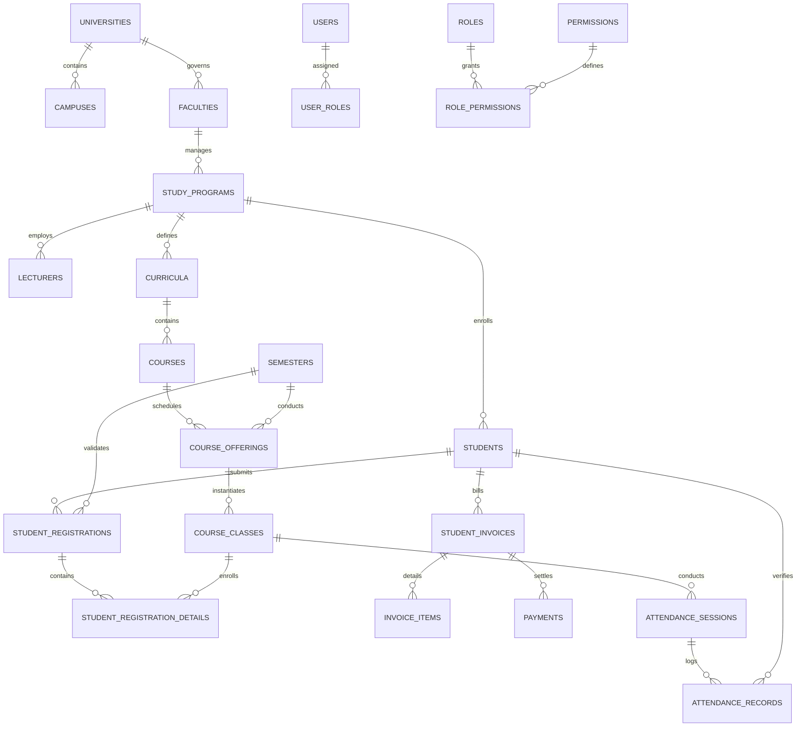

# ICMS Database Architecture Specification
**Integrated Campus Management System (ICMS) — PostgreSQL & Prisma ORM**
**Document Version:** 1.0.0
**Target Database:** PostgreSQL 16+ / 18

---

## 1. Architectural Philosophy & Integrity Standards

The ICMS persistence tier is built on PostgreSQL with strict relational modeling, domain segregation, and atomic transaction boundaries.

### Guiding Principles:
1. **Strong Referential Integrity**: Every sub-entity is tied to its master through explicit Foreign Key relationships with defined cascading or protect rules.
2. **UUID Primary Keys**: All business records utilize collision-resistant UUIDs to facilitate distributed safety and future replication.
3. **No Soft Deletion of Audit Trails**: Financial ledgers (`payments`, `student_invoices`) and academic grade history (`grades`, `student_registration_details`) are immutable; status transitions are governed by audit logs.
4. **ACID Transaction Guarantees**: Multi-table operations—such as KRS approval and invoice settlement—must execute within explicit database transactions (`prisma.$transaction`).
5. **Role-Based Scoping Indexes**: Composite indexes on `[userId, roleId, facultyId, studyProgramId]` allow instant sub-millisecond permission checks.

---

## 2. Domain Data Architecture

---

## 3. Core Domain Entity Breakdown

### 3.1 Authentication & RBAC (`users`, `roles`, `permissions`, `user_roles`)
- **`users`**: Central account identity with Argon2id password hash, MFA secrets, and verification flags.
- **`roles`**: System roles (`SUPER_ADMIN`, `RECTOR`, `DEAN`, `HEAD_OF_PROGRAM`, `LECTURER`, `STUDENT`, etc.).
- **`permissions`**: Granular permissions composed of `MODULE:ACTION` (e.g. `ACADEMIC:APPROVE`, `FINANCE:VERIFY`).
- **`user_roles`**: Polymorphic assignment table supporting optional `faculty_id` and `study_program_id` scope constraints.

### 3.2 Organizational Hierarchy (`universities`, `campuses`, `faculties`, `study_programs`)
- **`universities`**: Legal institution entity and accreditation.
- **`faculties`**: Academic faculties overseeing related study programs.
- **`study_programs`**: Bachelor (S1), Master (S2), or Diploma programs with specific curriculum rules.
- **`academic_years` & `semesters`**: Academic calendar timelines governing KRS enrollment windows.

### 3.3 Student Lifecycle (`students`, `guardians`, `documents`, `status_history`)
- **`students`**: Profiles with unique institutional NIM, entrance semester, current semester, GPA (IPK), and assigned Academic Advisor (`advisor_id` -> `lecturers`).
- Statuses: `PROSPECTIVE`, `ACTIVE`, `ON_LEAVE`, `INACTIVE`, `GRADUATED`, `WITHDRAWN`.

### 3.4 Academic Core & KRS/KHS (`curricula`, `courses`, `offerings`, `classes`, `schedules`, `registrations`)
- **`courses`**: Course codes, credits (SKS), types (`MANDATORY`, `ELECTIVE`), and prerequisite chains.
- **`course_prerequisites`**: Validates minimum grade requirement before allowing KRS selection.
- **`student_registrations`**: Semester registration document with SKS limits, advisor approval workflow, and timestamps.
- **`student_registration_details`**: Class enrollments with numeric score (0-100), letter grade (A-E), grade points (4.0-0.0), and publication flag.

### 3.5 Financial Operations (`student_invoices`, `invoice_items`, `payments`)
- **`student_invoices`**: Semester tuition bills with amounts, due dates, and statuses (`UNPAID`, `PENDING`, `PAID`, `CANCELLED`).
- **`payments`**: Transaction records with reference numbers, method types (`VIRTUAL_ACCOUNT`, `QRIS`, `TRANSFER`), and verified flags.
- **Security Rule**: Invoices are never marked as paid by client requests; verification must occur via signed webhook or authorized admin approval.

### 3.6 LMS, Library, and Supporting Tables
- Full domain coverage for `course_materials`, `assignments`, `assignment_submissions`, `exams`, `exam_attempts`, `books`, `book_loans`, `facilities`, and `audit_logs`.

---

## 4. Database Migration & Seeding Strategy
- **Prisma Schema (`prisma/schema.prisma`)**: Single source of truth.
- **Seed Script (`prisma/seed.ts`)**: Populates system roles, administrative users, and foundational lookup structures.

